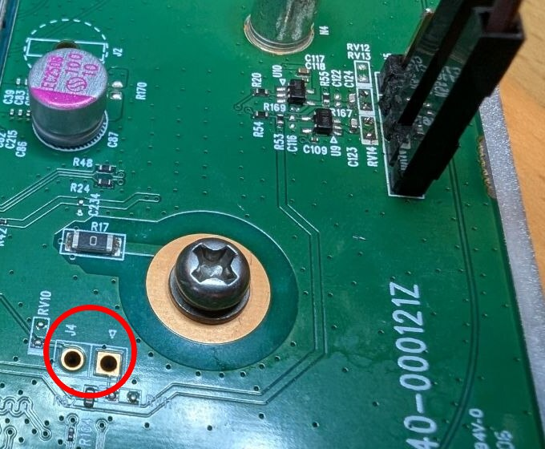

# Read-only config dump via EDL + offline password decryption

A **non-destructive** alternative to the firmware-editing + zycast method for recovering the
`admin` / `supervisor` / `root` passwords and the Wi-Fi keys:

1. put the modem into Qualcomm **EDL (9008)** mode with a hardware short,
2. read the config partition **read-only** with a firehose loader,
3. **decrypt** the `_encrypt_…` blobs offline (no WebUI oracle needed).

Nothing is written to the device, so the brick risk is essentially zero (as long as you only
*read*). It also works when the WebUI/SSH are inaccessible, without flashing a modified firmware —
and in particular **when the zycast flash method does not work on your unit**: on ours the zycast
multicast timing window never triggered (I swept the whole boot-time range and always missed it),
so a modified image could not be flashed at all, which is what led me to this read-only EDL route.

> ⚠️ For a device **you own**. Everything below is read-only. **Never run `w` / `wl` / `e` /
> `erase` / `program` in EDL** — a bad write bricks the module. Same disclaimer as the rest of this
> repo: do this only if you know what you are doing.

The NR7302 uses a soldered **Quectel RG520F-EB** (Qualcomm **SDX65 / "olympic"**, MSM_ID
`0x001610e1`), 32-bit ARM, NAND. The same approach should apply to NR7301/NR7303 and related
Quectel olympic modules.

**Prerequisite — the module's USB must reach your host.** EDL enumerates over USB, so you first need
the modem's USB lines (D+, D−, VBUS, GND) wired out to a host port. If your NR7302 doesn't have that
yet, follow the USB-port guide in this repo first: [Adding USB](../usb/README.md).

---

## 1. Enter EDL (9008) — hardware USB_BOOT short

On DTAG firmware there is no usable software EDL trigger (no DIAG port, AT port silent, adb gadget
mismatch). The firmware-independent way is the Quectel hardware method:

> Pull **`USB_BOOT`** to **`VDD_EXT` (1.8 V)** **before** power-on → QDLoader `05c6:9008`.

On the NR7302 carrier PCB both pads are at **`J4`** — the two pads circled in red below, next to the
mounting screw and below the `EC250x` electrolytic cap:

- the pad labelled **`J4`** (left) = **`USB_BOOT`** (0 V at rest, ~2.4 MΩ to GND),
- the adjacent pad toward the small **▽** silkscreen mark (right) = **`VDD_EXT`** (~1.8 V).



Steps: power off → short the two `J4` pads together and hold → power on (status LED staying **off**
is a good sign) → after ~5 s remove the short (EDL is already in RAM). Verify:

```bash
lsusb | grep 05c6:9008      # Qualcomm, Inc. Gobi Wireless Modem (QDL mode)
```

If neither `2c7c` (normal modem) nor `9008` (EDL) ever shows up, check the USB wiring first (see
[Adding USB](../usb/README.md)).

## 2. Get the matching firehose loader

Use bkerler's [edl](https://github.com/bkerler/edl) (`pip install pyusb pyserial pycryptodome`).
First read the identity with no loader:

```bash
python edl.py printgpt --debugmode
# HWID:    0x001610e1...  -> SDX65 / olympic
# PK_HASH: 0xd40eee56f3194665...
```

`PK_HASH d40eee56f3194665…` is the **Qualcomm default/sample** key hash → **no OEM key is fused**,
so secure boot does not enforce a vendor key and the module accepts any firehose built for the
olympic SoC. You need an **olympic / `SocOlympicLE`** firehose; a known-working one is attached to
[bkerler/edl issue #667](https://github.com/bkerler/edl/issues/667) (`firehose.zip` →
`prog_firehose_lite.elf`), identifiable by:

```bash
strings prog_firehose_lite.elf | grep -i olympic
# IMAGE_VARIANT_STRING=SocOlympicLE
# QC_IMAGE_VERSION_STRING=BOOT.MXF.1.1.1-00217-Olympic-2
```

(A unit that instead reports a *device-specific* PK_HASH would reject loaders not signed with that
key — not the case on these DTAG units.)

## 3. Dump the config partition (read-only)

```bash
python edl.py printgpt --loader=prog_firehose_lite.elf --memory=nand   # partition table
python edl.py r oemdata oemdata.bin --memory=nand --loader=prog_firehose_lite.elf
```

`oemdata` is mounted at **`/xdata`** and holds `zcfg_config.json`. If Sahara times out,
power-cycle into a fresh 9008 and upload the loader again (a failed Sahara transfer leaves the
loader stuck until a clean reboot).

Extract the UBI image:
```bash
pip install ubi_reader
ubireader_extract_files -o out oemdata.bin
#   out/<n>/oemdatafs/xdata/zcfg_config.json   (+ .bak)
```

> `oemapp`/`rootfs` volumes are **squashfs inside UBI** (so `ubireader_extract_files` fails with a
> UBIFS superblock error on those) — for them use `ubireader_extract_images` then
> `unsquashfs` the resulting `*.ubifs` volume. `oemdata` is a normal UBIFS volume and extracts
> directly.

## 4. Decrypt the `_encrypt_…` blobs offline

No WebUI oracle needed. The scheme (from `encryptPassword` / `aesEncryptCbc256` / `aes_init` in
`/bin/zcmd`, see also SEC Consult SA-20220215) is:

- **AES-256-CBC**, PKCS#7.
- key/iv via OpenSSL **`EVP_BytesToKey(md=SHA1, count=5)`**.
- **passphrase `ThiSISEncryptioNKeY`** — stored nowhere as a plain string; assembled byte-by-byte
  into the global `encryptKey` by the constructors `zcmdInit1..6` (anti-reverse).
- **salt `39 30 00 00 31 d4 00 00`** (the ints `12345` / `54321`, little-endian).

Use [`decrypt_zcfg_config.py`](decrypt_zcfg_config.py) in this folder:

```bash
pip install pycryptodome
python3 decrypt_zcfg_config.py out/*/oemdatafs/xdata/zcfg_config.json
# .../Account[1]/Privilege = 'login,httpd,samba,ssh'      <- correctness check
# .../Account[0]/Password  = '<admin password>'
# ...
```

Account model: the zcfg `root` account is the **web/management** root, not the Linux shell root
(`oelinux123`, the static OpenEmbedded default). `supervisor` is the SSH shell account, `admin` the
WebUI account. Once you have the passwords, log in over SSH / the WebUI on the LAN as usual.

---

### Credits
bkerler [edl](https://github.com/bkerler/edl) + issue #667 (olympic firehose); SEC Consult
SA-20220215 (Zyxel `_encrypt_` scheme); `ubi_reader`; `squashfs-tools`.
